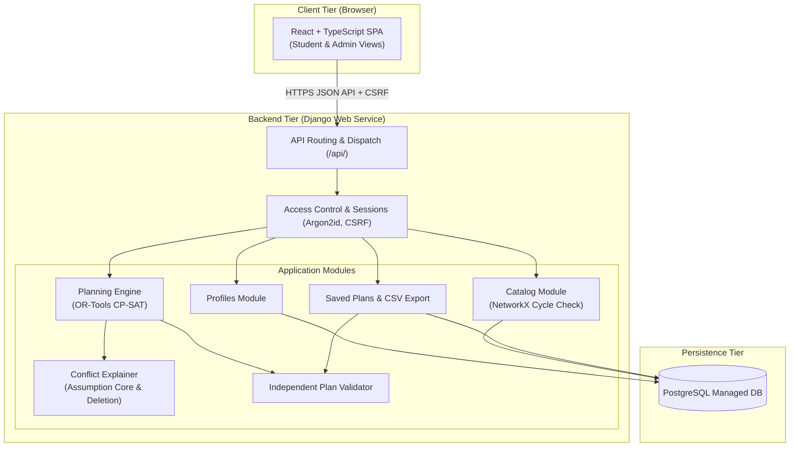
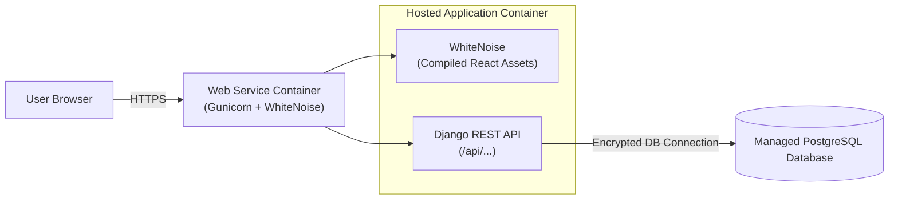

# DegreePath

> **Automated, constraint-aware academic degree planning for undergraduate Computer Science students.**

DegreePath is an intelligent degree planning system designed for NYU undergraduate Computer Science students. It eliminates the manual guesswork of academic tracking by automatically generating valid, semester-by-semester course schedules that satisfy complex departmental degree requirements, prerequisite structures (including AND/OR logic), corequisites, credit limits, and term offerings.

When degree completion is infeasible within a student's chosen constraints (such as graduation target date or credit caps), DegreePath isolates and explains the **minimal set of conflicting constraints**, empowering students and catalog administrators to identify solutions without trial-and-error.

---

## Table of Contents

- [Overview & Problem Statement](#overview--problem-statement)
- [Key Features](#key-features)
  - [Student Planning Experience](#student-planning-experience)
  - [Intelligent Constraint Solver & Conflict Explainer](#intelligent-constraint-solver--conflict-explainer)
  - [Independent Plan Validator](#independent-plan-validator)
  - [Catalog & Degree Rule Administration](#catalog--degree-rule-administration)
- [Architecture & System Design](#architecture--system-design)
  - [High-Level Architecture](#high-level-architecture)
  - [Core Backend Modules](#core-backend-modules)
  - [Data Model & CNF Representation](#data-model--cnf-representation)
  - [Deployment Model](#deployment-model)
- [Technology Stack](#technology-stack)
- [Architectural Decision Records (ADRs)](#architectural-decision-records-adrs)
- [Non-Functional Requirements (NFRs)](#non-functional-requirements-nfrs)
- [Project Documentation](#project-documentation)
- [Team](#team)

---

## Overview & Problem Statement

Academic planning in Computer Science involves navigating a complex web of prerequisites, co-requisites, alternating term availability (Fall vs. Spring), credit limits, and degree rule buckets (e.g., core courses, "choose $N$ from $M$" elective pools, 3000+ level credit thresholds). 

Existing university registration tools only validate enrollment at registration time, offering no forward-looking semester roadmap. Students frequently face graduation delays due to hidden prerequisite bottlenecks or unavailable off-cycle courses. 

**DegreePath** bridges this gap:
1. **Automates feasible roadmaps** from the student's current status through graduation.
2. **Guarantees plan validity** with an independent constraint checker.
3. **Explains infeasibility** by pointing directly to the conflicting requirements when a plan cannot be formed.

---

## Key Features

### Student Planning Experience
- **Profile & Course History Tracking:** Students record completed courses, declared programs, per-term credit bounds (1–24 credits), and target graduation terms.
- **Automated Semester-by-Semester Planning:** One-click generation of a valid schedule mapping courses from the upcoming term through the target graduation term.
- **Plan Lifecycle & Staleness Detection:** Plans can be saved, named, reopened, or deleted. If a student updates their course history or the department catalog changes, existing plans are flagged as `"Out of date — regenerate"`.
- **Advisor Export:** Students can export valid plans as structured CSV files (`term, course_code, title, credits`) to share with academic advisors.

### Intelligent Constraint Solver & Conflict Explainer
- **Multi-Constraint Optimization:** Powered by Google OR-Tools CP-SAT, balancing prerequisite DAGs, AND/OR logic clauses, corequisites, seasonal term offerings, credit caps, and elective pools.
- **Deterministic Scheduling:** Generates repeatable plans using fixed solver seeds and deterministic time budgets.
- **Minimal Conflict Extraction (US-12):** When a graduation timeline is impossible (e.g., 5-term prerequisite chain remaining with only 4 terms until graduation), the explainer runs an assumption core extraction and deletion pass to isolate the exact conflicting constraints in plain language.

### Independent Plan Validator
- To protect against solver modeling bugs, an **independent Plan Validator** inspects every generated plan before it reaches the UI or gets committed to the database (NFR-4).
- Neither solver output nor client-submitted plans are ever trusted without passing validator checks.

### Catalog & Degree Rule Administration
- **Transactional Imports:** Department administrators upload course catalogs and degree rule requirements via CSV or JSON files.
- **All-or-Nothing Integrity:** Import processing runs in an isolated database transaction (`transaction.atomic`). Any formatting error, unknown reference, or prerequisite cycle immediately rolls back the entire batch.
- **Cycle & Contradiction Detection:** Leverages NetworkX to detect prerequisite cycles (e.g., $A \to B \to C \to A$) and prerequisite-corequisite contradictions (e.g., $A \to B \to C \rightleftarrows A$) before data ever enters the active catalog.

---

## Architecture & System Design

DegreePath follows a clean **client-server architecture** comprising a React/TypeScript Single Page Application (SPA), a modular Django API backend, and PostgreSQL.

### High-Level Architecture



### Core Backend Modules

1. **Access Control (`AccessControl` / `AuthService`)**:
   - Manages user registration, session authentication, and role verification (Student vs. Administrator).
   - Enforces ownership checks on profiles and saved plans (returning HTTP 403 on unauthorized access).
2. **Profiles (`ProfileService`)**:
   - Manages student profiles, completed course lists, target terms, and per-semester credit boundaries.
3. **Catalog (`CatalogService` / `ImportService`)**:
   - Handles course search, term offerings, and transactional imports with NetworkX graph cycle detection.
4. **Planning Engine (`PlanningEngine`)**:
   - Reads an immutable `PlanningInput` snapshot.
   - Formulates and executes the CP-SAT constraint optimization model.
5. **Conflict Explainer (`ConflictExplainer`)**:
   - Solves infeasible models using assumption literals to isolate minimal conflict cores under a 28-second operational budget.
6. **Plan Validator (`PlanValidator`)**:
   - Standalone module that evaluates course sequence validity, prerequisite satisfaction, corequisites, and pool allocations without database or solver dependencies.
7. **Saved Plans & Export (`PlanService` / `ExportService`)**:
   - Manages plan persistence, staleness evaluation against profile/catalog version hashes, and CSV export.

### Data Model & CNF Representation

Course prerequisites are stored normalized in **Conjunctive Normal Form (CNF)** (AND of ORs):
- **`PrereqClause`**: Represents each AND-ed group.
- **`PrereqClauseCourse`**: Represents each OR-ed course option within a clause.
- **`Corequisite`**: Canonical pairs enforcing $course\_id < coreq\_course\_id$.
- **`Requirement` & `RequirementCourse`**: Degree requirements categorizing courses as `required`, `pool` ("choose $N$"), or `credit_threshold`.

### Deployment Model



---

## Technology Stack

| Layer | Technologies |
| :--- | :--- |
| **Frontend** | React 18, TypeScript, Modern Component Library, Vite / Webpack |
| **Backend Framework** | Python 3.11+, Django, Django REST Framework (DRF) |
| **Constraint Solver** | Google OR-Tools (CP-SAT Constraint Programming Solver) |
| **Graph Analysis** | NetworkX (prerequisite cycle detection & corequisite contraction) |
| **Database & ORM** | PostgreSQL, Django ORM |
| **Security & Auth** | Argon2id password hashing, Django DB-backed sessions (24-hour expiry), CSRF protection |
| **Static Serving / WSGI** | WhiteNoise, Gunicorn |
| **CI / CD & Tooling** | GitHub Actions, Git, GitHub CLI (`gh`), Pytest |

---

## Local Setup

Requires Python 3.11 and Node.js 20 or later. From the repository root, start the backend (Windows PowerShell):

```powershell
python -m venv .venv
.\.venv\Scripts\python.exe -m pip install -r backend\requirements.txt
cd backend
..\.venv\Scripts\python.exe manage.py migrate
..\.venv\Scripts\python.exe manage.py runserver
```

From the repository root in a second terminal, start the frontend:

```powershell
cd frontend
npm install
npm run dev
```

Open the URL printed by Vite. Students can register there; administrators can be created with `..\.venv\Scripts\python.exe manage.py createsuperuser` from `backend`. For a catalog demo, upload [demo_courses.csv](backend/catalog/demo_courses.csv) from the administrator's **Import catalog** page.

To check the project, run `..\.venv\Scripts\python.exe manage.py test` from `backend` and `npm run build` from `frontend`.

---

## Architectural Decision Records (ADRs)

- **[ADR-01] React Frontend with Django Backend & Sessions:**
  - Selected Django session-based authentication with `HttpOnly`, `Secure`, and `SameSite=Lax` cookies with CSRF protection over stateless JWTs to simplify secure session invalidation and role management.
- **[ADR-02] Transactional Imports for Course Catalog & Requirements:**
  - Enforced single-transaction atomic imports (`transaction.atomic` with savepoints) so invalid rows or prerequisite cycles completely roll back, preventing catalog corruption.
- **[ADR-03] Google OR-Tools CP-SAT for Planning & Conflict Explanation:**
  - Chose CP-SAT over greedy heuristics or linear programming (PuLP). Enabled direct modeling of boolean logic, elective pools, and automated extraction of minimal conflict sets using assumption literals.
- **[ADR-04] Normalized CNF Tables for Prerequisites:**
  - Modeled prerequisites as Conjunctive Normal Form relational entities (`PrereqClause`, `PrereqClauseCourse`, and canonical `Corequisite`) rather than raw JSON strings to guarantee referential database integrity.

---

## Non-Functional Requirements (NFRs)

- **NFR-1 (Permissions):** Centralized ownership verification prevents any student from accessing or modifying another student's profile or plans (HTTP 403). Profile IDs and Plan IDs use random UUIDs.
- **NFR-2 (Security):** Passwords hashed using Argon2id; sessions expire after 24 hours; CSRF token validation on all state-changing endpoints.
- **NFR-3 (Performance):** Plan generation completes in $\le 10$ seconds (95th percentile). Conflict explanation finishes within a 28-second deadline.
- **NFR-4 (Data Integrity):** 100% of generated plans pass the independent validator before persistence; catalog imports operate with all-or-nothing guarantees.
- **NFR-5 (Privacy):** Request bodies for authentication, profiles, and plans are never written to server logs; canary string tests verify log sanitation.
- **NFR-6 (Persistence):** All profiles, plans, and catalog versions persist reliably in PostgreSQL across server and container restarts.

---

## Project Documentation

Detailed specification and architecture documents are maintained in the [`docs/`](./docs) directory:
- 📄 [Sprint 1 Requirements Specification](./docs/Software%20Engineering%20Sprint%201_%20Requirements.pdf) — Complete user stories (US-01 to US-18), acceptance criteria, personas, and out-of-scope definitions.
- 📄 [Sprint 2 Architectural Design Document](./docs/Software%20Engineering%20-%20Sprint%202%20Design.pdf) — Component models, sequence diagrams (plan generation, catalog import, conflict explanation), ER diagrams, ADRs, and traceability matrix.

---

## Team

- **Omkar Gadute**
- **Achyuthan Sivasankar**
- **Maitri Savaliya**
- **Han Yang**
- **Hanyue Liao**

*Course: Software Engineering I (CS-GY 6063) — NYU Tandon School of Engineering*
